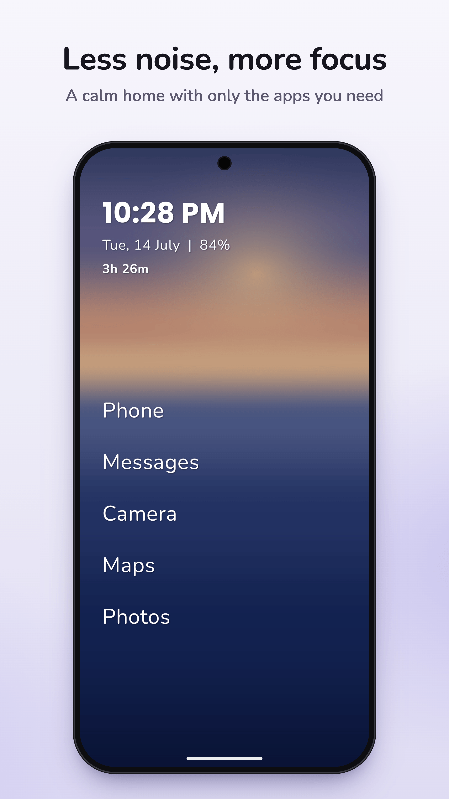
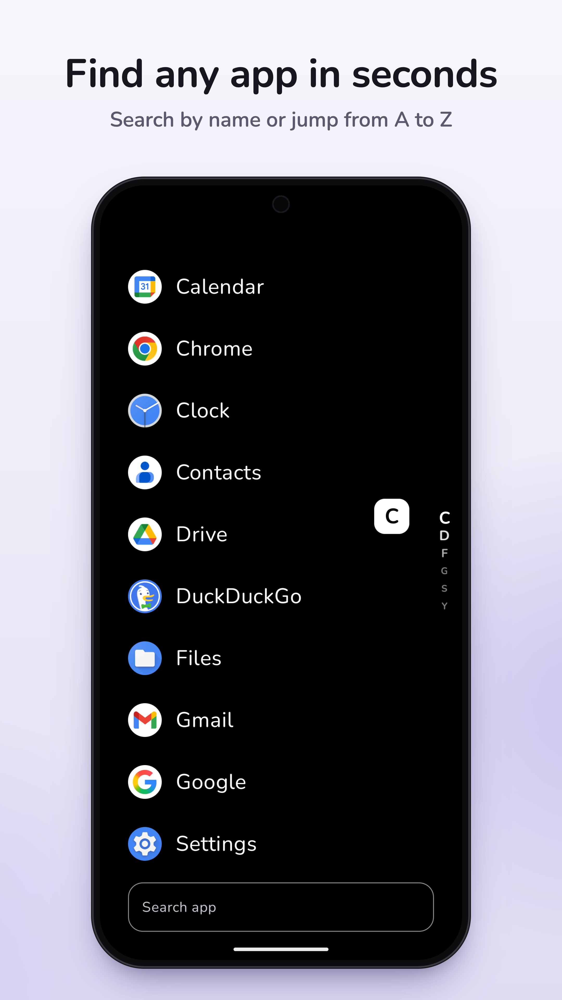
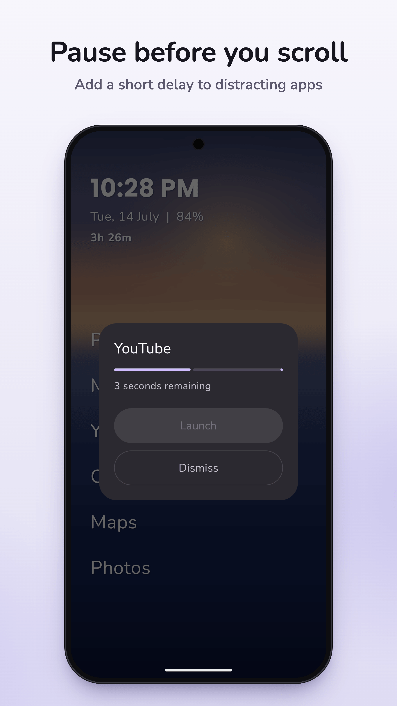
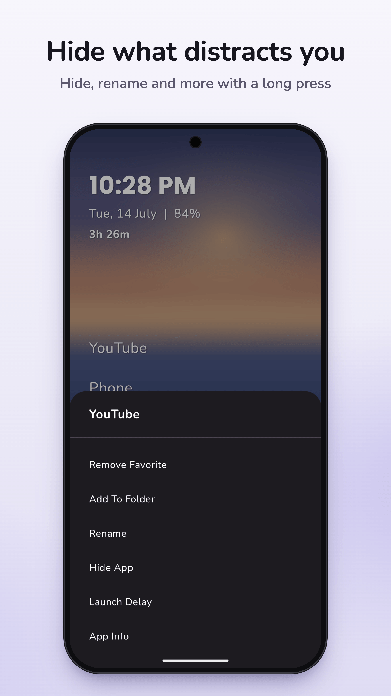
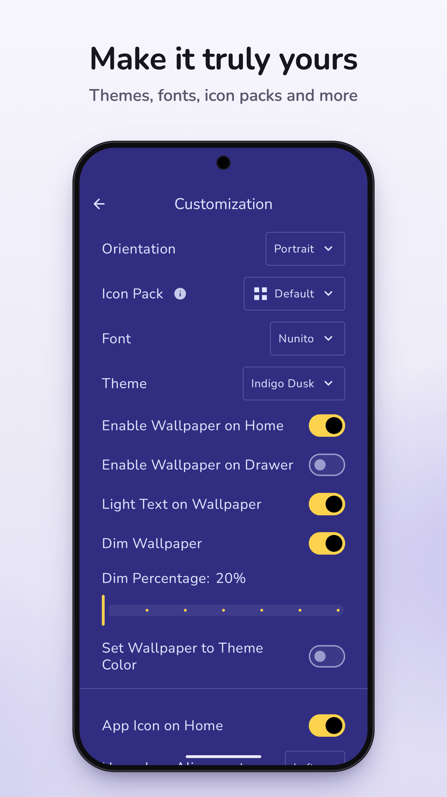
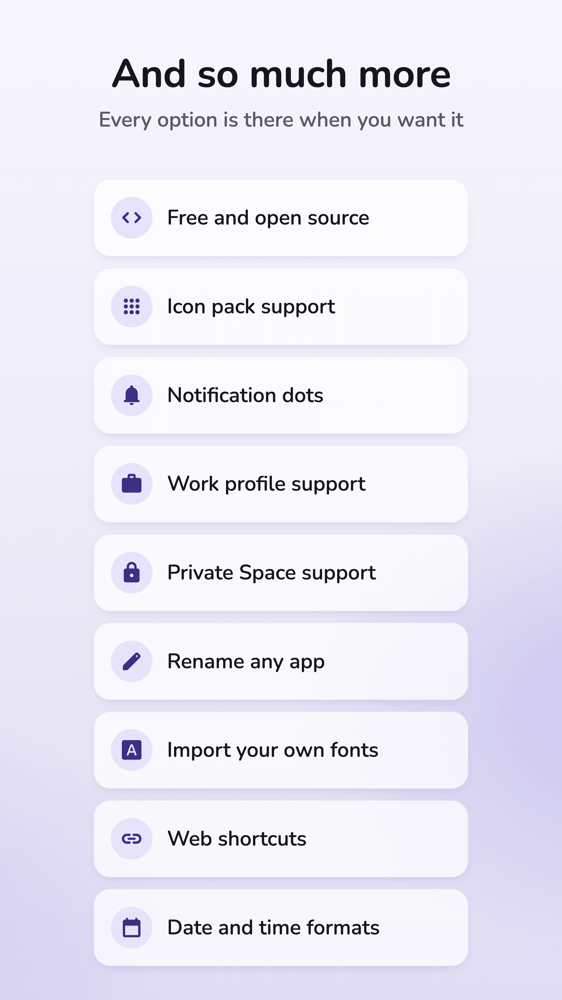

# Minimo

Minimo is a free, open-source minimalist launcher for Android. It replaces cluttered icon grids with
a clean, text-first home screen and a fast app drawer, helping you cut down screen time, avoid
distractions, and use your phone with intention.

## Screenshots:

  
  
  

  
  
  

## Key Features:

- **Focus and Digital Wellbeing**: Keep a few favourite apps on the home screen or none at all. Hide
  distracting apps, add a Launch Delay before an app opens, and track usage with the daily
  screen-time widget.
- **Fast App Drawer and Search**: Instant search with "contains" or "starts with" matching,
  auto-open
  for a single result, Done to open the first result, A-Z fast scroller, auto-opening keyboard, and
  a search bar you can move to the bottom or hide.
- **Folders and App Management**: Group apps into folders, rename or hide apps, reorder favourites,
  and open app info or uninstall right from the launcher.
- **Gestures and Shortcuts**: Swipe left or right to open apps, double-tap to lock, Back to open the
  drawer, long-press to open settings, tap widgets to open apps of your choice, and pin shortcuts
  and
  web shortcuts.
- **Personalisation**: Text-only or icons with icon pack support, custom fonts (.ttf), size, spacing
  and alignment controls, light, dark, AMOLED black, and Material You dynamic themes, wallpaper
  dimming, 12/24-hour clock, date format, battery level, notification dots, and hideable status and
  navigation bars.
- **Private Space**: Lock, unlock, and open apps from Android Private Space in the app drawer.
- **Privacy and Open Source**: No ads, no tracking, and no personal data collection. The source code
  is available to review and contribute to.

## Download:

## Tech stack & Libraries

- Minimum SDK level 26.
- Target SDK level 37.
- [Kotlin](https://kotlinlang.org/) based,
  utilizing [Coroutines](https://github.com/Kotlin/kotlinx.coroutines) + [Flow](https://kotlin.github.io/kotlinx.coroutines/kotlinx-coroutines-core/kotlinx.coroutines.flow/)
  for asynchronous operations.
- Jetpack Libraries:
  - [Jetpack Compose](https://developer.android.com/compose)
  - [Lifecycle](https://developer.android.com/jetpack/androidx/releases/lifecycle)
  - [ViewModel](https://developer.android.com/topic/libraries/architecture/viewmodel)
  - [Navigation](https://developer.android.com/guide/navigation)
  - [Room](https://developer.android.com/jetpack/androidx/releases/room)
  - [DataStore](https://developer.android.com/jetpack/androidx/releases/datastore)
  - [Hilt](https://dagger.dev/hilt/)
- [Timber](https://github.com/JakeWharton/timber)

## Socials:

- [Join Reddit](https://www.reddit.com/r/MinimoLauncher)
- [Join Discord Channel](https://discord.gg/f4wpPppCDk)
- [X/Twitter](https://x.com/VaibhavLakhera)
- [LinkedIn](https://www.linkedin.com/in/vaibhav-lakhera/)
